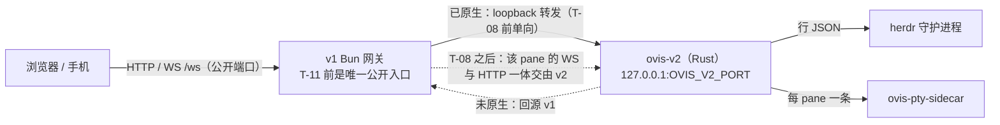

# Ovis v2 — Rust 网关 · 第 3 稿（评审第 2 轮后）

> 依据：`local://ovis-v2-review.md`（第 1 轮，8 阻断）与 `local://ovis-v2-review-round2.md`（第 2 轮，4 条未闭合 + 1 条新增 B1）。本稿逐条闭合；第 3 轮评审是最后一轮。

## 0. 基线与已落地

| 组成 | 实测 | 说明 |
|---|---|---|
| Rust PTY host（已切换） | 0.72 / 0.83 MB / pane | 对 Node 的 39.4 MB；真机 `echo p0-ok` 往返正常 |
| v1 Bun 网关（11 pane，5.5 h） | 161 MB | 非标准化工作负载，仅作起点 |
| 前端 | 2.68 + 1.43 + 0.82 MB | `dist` 38 MB |

## 1. 归属单元：连接 + 它的 pane 级 HTTP（R1-2）

v1 的一条浏览器连接不是「一个 WS」，而是 **WS + 一组使用该连接 ID 的 HTTP 路由**：

- `create` 请求带 `newSession.ts:67-72` 的连接 ID，v1 的 HTTP 侧 `queueFirstMessage` 在自己的进程里找 client（`dispatch.ts:473-479`、`core/pending.ts:790-822`）；
- `/api/pane/prompt/answer` 走 v1 的 `serialize`（`dispatch.ts:548`）；
- 访问判定的结果（`readOnly`/`deviceId`/`promptScreenOnly`/`recheckMs`，`dispatch.ts:289-318`）与吊销订阅（`core/connections.ts:134-152`）都属于连接。

因此 v2 的归属单元定义为：

> **一个 pane 的归属 = 它的 WS 帧 + 所有以该连接 ID 携带状态的 HTTP 路由（create 首消息、prompt answer、pane 变更、attachment 相关）。**

切换（T-08）以 pane 为单位一次完成；同一 pane 的 WS 与上述 HTTP **必须同进程**，跨进程混用视为设计错误，由 T-08 的用例拒绝（同 pane 两归属 → 必须失败）。

## 2. 安全边界（R1-1）

- **公开端口在 T-11 之前不动**；v2 只监听 loopback。
- **T-10（访问层对等）是 T-08 的硬前置**（第 2 轮指出 T-08 只依赖 T-04/T-07，已改）。T-10 交付：`peer/转发头/token/device/Portal` 判定 + **ingress 集成**（不只是纯函数）——HTTP 与 WS 两条都断言，含吊销订阅。
- 若 v2 在 T-08 之后承载某 pane，则该 pane 的 HTTP 与 WS 都由 v2 做访问判定；**v1 绝不再对该 pane 做第二次判定**（避免双判定与绕过），由 T-08 用例断言（同一请求只出现一个 `x-ovis-served-by`）。

## 3. 传输与背压（R1-3，已闭合）

按 v1 原样：ACK 高水位 256 KiB、低水位 64 KiB、传输硬顶 1 MiB、停滞与共享暂停预算、关闭码 4008（`server/output-window.ts:3-17,67-117`、`core/connections.ts:100-112,202-214`）。**没有 `resync`**（`shared/protocol.ts:1069-1136` 无此类型）。

## 4. 输入与提交（R1-4，已闭合）

普通键入后 40 ms、尾随 ESC 后 300 ms；按键走 RPC 并与 composer/Stop 串行；每次写入前复核角色代次、附件、租约、ready/held；镜像与 Windows 走 RPC（`server/index.ts:50-64`、`core/input.ts:50-69,88-121,134-166,208-249`）。

## 5. 会话与任务（R1-5 闭合，R1-6 保持代理）

- conversation：必须复刻 clear/fork/ancestry 掩码、工具/通知身份、子 agent 元数据（`server/conversation.ts:365-439,671-700,749-765`、`claude-transcript.ts:529-541,706-717`）。尾读是优化，**不是语义前提**。
- `omo-tasks` 及四类数据源在 v2.0 **原样代理**（`server/tasks-routes.ts:34-75`、`omo-tasks.ts:65-125`、`claude-subagents.ts:5-40`）。

## 6. 清单机制（R1-7）

`scripts/v2-inventory.ts` 扫描**调用点**（`machinePath`/`machineRequest`/`cliProxyRequest`/`fetch`/`*Json` 及 `/api/...` 字面量），并把结果与**人工审过的** `scripts/v2-route-allowlist.json` 做**双向差集**：扫到未审 = 失败；审过但不再被调 = 失败。当前：**18 client / 25 server 帧；98 个路由模板**。

**已知静态盲区（明确写下，不假装完整）**：以表达式拼路径的调用（如 `machineRequest(\`/${encodeURIComponent(id)}/update-bridge\`)`）扫不到；辅助函数前缀以外拼装的路径也扫不到。因此**完备性由运行时对账负责**（T-02）：v1 在 fixture 模式下记录 `method + 归一化 path + local/remote target`，跑遍全部页面/对话框/错误分支（含 POST/DELETE/SSE/登录回调），要求 **trace ⊇ 静态清单**，且 trace 里每个操作都要在 fixture 清单中登记。静态清单是下限，运行时是上限。

## 7. 架构（阶段标注修正，N3）

## 8. 步骤（14 步；validator 三条件：HEAD 红 / 错实现红 / v1 顶替不通过）

provenance 按**面**定义（不是全局停 v1）：原生路由在 v1 停止时仍必须正确；代理路由在 v1 停止时必须失败；每条断言都能看到 `x-ovis-served-by`（测试构建注入）。

| id | 步骤 | 关键交付 | 验收 |
|---|---|---|---|
| T-01 | 骨架（仅 loopback） | 静态 200/206/304、编码协商、`--selftest`、优雅退出 | 绑定地址断言（非 loopback 必须拒绝启动）+ Range/ETag/编码；v2 不在时红 |
| T-02 | 全量 HTTP 代理（SSE/取消）+ **运行时路由对账** | `proxy.rs`、trace fixture | trace ⊇ 静态清单；SSE 增量与取消；v1 停 → 代理失败 |
| T-03 | herdr RPC | 行 JSON、超时、错误码、`ping` 版本 | **正常/半帧/超时/坏版本四类**：正常必须成功，异常必须拒绝（只拒绝的实现会挂） |
| T-04 | `/api/session` 原生 | 快照 + `finish_*` | 结构/关系相等 + v1 停仍答 |
| T-04b | **pane HTTP 原生**（B1） | `/api/pane/read`（GET）、`/api/pane/scroll`（GET/POST）、`/api/pane/find`（POST）、`/api/pane/selection`（GET）、`/api/pane/plan`（GET） | 每个方法一条成功 + 一条参数错误 + `format` 变体（text/ansi）+ v1 停仍答 |
| T-05 | 输出窗口 + PTY | 水位/硬顶/4008/sidecar 生命周期 | 30 min、有序字节零丢失、慢消费者被关；**经 test-only 传输**（见下） |
| T-06 | 输入与按键顺序 | 40/300 ms、代次复核、镜像回退、insert/secret | 与 v1 逐字节时序对拍（受控时钟）+ Stop/队列交叠 |
| T-07 | 提交与排队 | submit/pending/租约/草稿/断线恢复 | 四态状态机 + **HTTP create 首消息边界**与 v1 对拍 |
| T-08 | 归属切换（WS + pane HTTP 一体） | 每 pane 一次判定；拒绝同 pane 双归属 | 帧序等价、双归属被拒、访问判定只出现一次；**前置 T-10** |
| T-09 | conversation 原生 | ancestry 掩码、工具/通知、子 agent 元数据 | 25 轮+rewind、clear、工具/通知、元数据变更、44 MB 五模式 |
| T-10 | 访问层对等（含 ingress） | HTTP + WS 两条都走 v2 判定 + 吊销订阅 | v1 `access.test.ts` 全用例 + 直接/经代理两种请求 + 吊销生效 |
| T-11 | 公开端口切换 + 回退协议 | 排空、租约、sidecar 收尾、`OVIS_V2=0` | 每种 pending 态（queued/held/sending/uncertain）下的切换与恢复各一条；≤5 s 回滚；端口/PID 归属断言 |
| T-12 | 浸泡 + 影子差分 + 指标 | 30 min / 11 pane / 1 万帧每分 | 进程树 RSS（v2+v1+sidecar）、p95、丢帧；只看 Rust PID 判不通过 |
| T-13 | 发布与安装 | 资产 + 幂等安装 + 回滚文档 | 干净前缀：装/启/停/重装/回滚；运行中二进制与资产 SHA 绑定 |

**test-only 传输（R1-8）**：T-05..T-07 在公开端口仍是 v1 期间无法被验证；v2 提供**仅测试构建**的 loopback 入口（`--test-listen`，带 fixture core、注入 `x-ovis-served-by`），使这三步可以在 T-08 之前完成自证。生产构建不含该入口（T-13 断言）。

## 9. 内存（N2）

- 输出窗口按**连接**计（1 MiB 硬顶），不设全局 ring。
- transcript 索引：**字节预算 32 MB + 准入/淘汰策略 + 并发与单条超大记录的拒绝阈值**；解析产物、mmap 常驻、序列化在途分别计量，报**峰值**与 5 s 采样两组。
- 目标 40 MB 只对 **Rust 进程**成立；整机口径必须同时报进程树（含 v1 与 sidecar）。

## 10. 测量（N1）

| 目标 | 方法 |
|---|---|
| RSS | fixture 工作量（11 pane、1 万帧/分、字节分布固定），warmup 5 min，30 min；Rust-only 与进程树两套；报峰值 |
| 按键→回显 | 浏览器 `performance.mark`（输入事件到 xterm 解析回调），500 次，四类输入分开，报 p50/p95/p99；不得为达标删掉正确性等待 |
| 切 pane 首帧 | 切 pane → **首个与当前目标一致的已解析帧**；冷/热/镜像/远端分开；回放字节标记为回放，不算就绪 |
| 44 MB transcript | fixture 哈希固定；冷进程/热页缓存/热索引/追加/回退五模式；HTTP 响应完成时间 + 峰值 RSS |
| 冷启 | spawn → **鉴权成功且 `/api/session` 成功**（不是 `/ws` 首帧：`core/socket.ts:118-133` 先发 `features`）；Rust-only 与整机两套 |
| 二进制 | 固定 target/toolchain/features/strip；报实际 release 字节，sidecar 与保留的 v1 资产单列 |

## 11. 风险

| 风险 | 对策 |
|---|---|
| 归属切换跨 HTTP/WS 走错 | §1 的单元定义 + T-08 双归属拒绝用例 |
| 访问层双判定或绕过 | T-10 前置 + `x-ovis-served-by` 断言 |
| 清单漂移 | 双向差集 + 运行时 trace 上限 |
| 只在测试构建可验证 | `--test-listen` 不进生产（T-13 断言） |
| 工具链 | `cargo +1.96.1`（本机 `stable` manifest 损坏） |

## 12. 已知 v1 存量问题（不在本方案内）

`server/pty/host.test.ts` 两条 `probeRustHost` 在本机恒红（`/bin/true` 在 macOS 不存在；250 ms 预算下 spawn 假 host 超时）。单独修。
