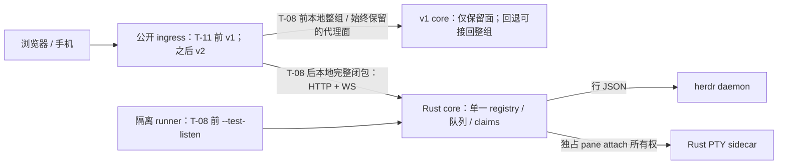

# Ovis v2 — Rust 网关 · 第 4 稿

> 设计依据：`local://ovis-v2-review.md`、`local://ovis-v2-review-round2.md`、`local://ovis-v2-review-round3.md`。以下是待实现契约，不是 v2 已通过验收的声明；代码事实给出仓库定位，未复测的历史数字注明来源。

## 0. 基线与已落地

| 组成 | 已提供的测量 | 口径 |
|---|---|---|
| Rust PTY host（已服务 attached terminals） | 0.72–0.83 MB RSS/pane；Node 39.4 MB；二进制 0.4 MB | 任务提供的历史实测，本稿未重测；不是 Rust 网关成绩 |
| v1 Bun 网关 | 11 pane / 5.5 h 时 RSS 161 MB | 任务提供的非标准化工作负载，不能与 §10 直接比较 |
| 前端 | entry 2.68 MB + elk 1.43 MB + worker 0.82 MB | 任务提供的构建体积；本次不调整前端 |

构建固定 `cargo +1.96.1`；本机默认 stable manifest 损坏为任务已报告的环境事实，不重试用户故障，也不据此推断 v2 能构建。

## 1. 归属单元：完整连接闭包

浏览器在同一 socket 重放所有 attachments；`attach()` 给该 socket 增加 pane 状态，同时清 readiness、变更 lease、发送 attach/可选 conversation-watch，并可重连 stopped socket，而非为每 pane 开新 socket（`src/lib/ws.ts:332-343,732-748`）。服务端每连接一个 ID、attachments/output map、一份 role generation 和 watches（`server/core/connections.ts:33-49`），role/presence 在该连接路由（`server/core/socket.ts:89-105,141-150`）。因此不能按 pane 或帧类型拆一个 socket。

HTTP 也进入这个闭包：创建请求携带 `first_message_connection`（`src/lib/newSession.ts:66-72`），workspace dispatch 把 `queueFirstMessage` 交给创建处理器，后者在本 core 的 clients 中找该 ID（`server/dispatch.ts:473-479`、`server/core/pending.ts:790-822`）；prompt answer 使用同一 pane 的 serialize（`server/dispatch.ts:546-548`、`server/core/input.ts:50-58`）。

**迁移单元 = socket + 它的全部有状态 HTTP + 全部 attached/watched pane claims + 共享这些 pane 的其他 clients，再递归闭包到不再增加成员。** 为避免动态闭包合并竞态，本版选择所有本地闭包的并集，即一次迁移整个 local core；不实现部分组切换。停准入覆盖新连接、attach/watch、create/首消息与输入；切换期间新请求拒绝或明确要求重试，不偷偷交给另一 core。

T-07 在这个单元内实现统一 registry、输入队列、create/首消息、prompt read/answer 与恢复记录；T-08 才把整组生产 HTTP/WS 接进它；T-11 对同一整组执行回退。T-08 同时等待 T-09 的 conversation/watch 语义，不能把尚未迁移的有状态帧转发到另一个 core。所有本地协议帧在 T-08 完整归属；未知帧行为也纳入对拍。

远端保持整 socket 与对应有状态 HTTP 代理，不把远端帧混入本地 core；v1 的远端选择由升级时 `machine_id` 创建 relay（`server/dispatch.ts:301-312`）。T-02/T-08 必须证明目标不可变、local/remote ID 不串组。闭包 fixtures 固定为 **一 socket 两 pane、两 clients 一 pane、role/吊销、create 首消息 HTTP（规范路径与 local alias 各一组）、prompt answer 与 Stop 交叠、断线重连 replay**；T-07 测状态，T-08/T-11 分别在真实正向迁移/回退的每个状态重跑。

**先规范化 alias，再选 owner**：v1 在 machines 可用时将 `/api/machines/local/*` 改写成同一 `/api/*` 本地路由，并检查 Origin、非 GET 的 `x-herdr-machine` 与允许路径集合；machines 不可用则拒绝（`server/dispatch.ts:263-271`）。local-alias tab create 有活跃契约用例（`server/api.contract.test.ts:1614-1624`）。T-02/T-08 在所有 ingress 的 owner 选择前统一规范化，保留原 spelling 供上述限制校验；不得因 `machines` 前缀回源 v1。T-07/T-08/T-11 必测带 Rust 连接 ID 的 aliased create/首消息与同 socket 的另一 pane，确认进入同 registry、只发送一次；机器开关关闭、非法 alias/缺必要请求头按原语义拒绝。

## 2. 安全边界

v1 在路由前执行访问判定，输入含 token/device/Portal 等身份（`server/dispatch.ts:160-193`）；loopback 与 forwarded 的结果不同，token 优先于 device（`server/access.ts:250-280`）；WS 保存只读、device、Portal recheck，并订阅每连接吊销（`server/dispatch.ts:294-318`、`server/core/connections.ts:131-152`）。不得把回源的 loopback 当成用户的原始身份。

- **T-11 前公开端口仍是 v1，Rust 仅 loopback；T-10 是 T-08 硬前置。** T-01..T-07/T-09/T-10 仅用隔离实例验证，不能提前转移用户连接。
- T-08 的 v1 ingress 必须在原有应用判定之前按归属路由：本地原生组由 v2 判定一次，v1 只传输；保留代理面由 v1 判定一次，v2 只传输。T-11 反转公开入口但不改变这个 owner 表；Portal 自有操作在 Portal fixture 单列，不冒充 Ovis 判定。
- 新增私有 ingress Interface：启动器建立受保护通道/凭据，传递原 peer、原始 forwarded/Host/Origin/token/cookie/Portal 证据与 request ID；接收者验证通道后重建请求语义。外部同名内部字段一律剥离，伪造/直连私有入口拒绝；loopback 本身不是授权。此为 T-02/T-10/T-08 新实现，不是假定 v1 已支持。
- T-10 同时交付 HTTP/WS ingress、watch 写限制、Origin、合法/伪造转发、Portal recheck，以及设备状态/吊销到新 owner 的受保护同步；重连重新判定，角色与租约写前检查不省略。同步中断不能继续使用已失效权限。
- **证明不用响应头计数。** instrumented 构建在 v1/v2 真实 admission 判定入口发出 `(request_id, target, owner, result)` 事件。每个 HTTP/WS fixture 预先声明预期阶段：到达 admission 则恰为 1（含该阶段鉴权拒绝）；私有通道校验提前拒绝则为 0、没有 admission owner，并观测对应 channel-reject。写前角色复核另记事件。合法通道的双判定/跳过判定 mutant 必须红，不能把绕过伪装成预期提前拒绝。
- provenance 独立证明：fixture runner 绑定 spawn 的二进制哈希/PID/监听端口；代理还须观测关联 request 的真实 upstream hop，RPC 须观测 Rust 到 fixture daemon 的连接。T-08 分两套产物：**ordinary 构建**测真实 ingress、alias/闭包、正向交接矩阵与 native/proxy provenance；**instrumented 构建**另测 decision-event owner/count 和鉴权 mutants。同 revision、各自记录 v1/Rust SHA 与构建 flags，不能用后一套结果证明前一套发出事件。标记头仅诊断；远端/Portal 鉴权按目标记账。T-13 发布 ordinary SHA，并证明该产物无测试 listener/事件入口。

## 3. 传输与背压

保留 ACK 高 256 KiB / 低 64 KiB、1 MiB transport cap、stall/join/shared-pause 预算与 4008（`server/output-window.ts:3-17,67-117`、`server/core/connections.ts:100-112,202-214`）。ACK window 是每连接内的 pane/stream 状态，transport 队列由同 socket 全 pane 共享（`server/core/connections.ts:33-38`、`server/output-window.ts:88-98`），不是每 pane 独占 1 MiB 的保证。

不丢旧字节、不重复发送已入队帧；v1 send 的 `-1` 表示已入队（`server/core/connections.ts:100-109`）。不新增 `resync`，现有 ServerMessage union 没有它（`shared/protocol.ts:1069-1136`）。T-05 检查顺序内容、ACK stream 身份/重复 ACK、水位边界、预算与精确关闭码，而非只检查“慢客户端断开”。

## 4. 输入与提交

按键经 RPC，与 composer/Stop 在 pane 队列串行；keys 在普通 typing 后等 40 ms、尾随 ESC 后等 300 ms（`server/index.ts:50-64`、`server/core/input.ts:50-69,134-166,208-249`）。镜像/Windows 无 attach 分支经 RPC，角色代次与 mayType 在路径 guard 之外复核（`server/core/input.ts:88-121,208-249`）。T-06 以受控时钟验证最小等待/因果序，并逐路径保留 guard，不能把 PTY 条件套给所有路径（`server/input-guard.ts:69-90`）：

| 路径 | 写前 guard（连接授权另检） |
|---|---|
| herdrTyping | sameClaim 且 sameOrigin；原是成员则 sameAttachment+member，否则要求现在无 attachment |
| queuedTyping | sameAttachment、samePty、sameClaim、member、ready，且非 held |
| keys | 非 currentHeld；有 origin 时再要求 sameAttachment、samePty、ready、sameClaim、member |
| mirrorSecret / pendingLease | 前者 sameAttachment+samePty+sameClaim+member；后者 sameAttachment+samePty+claimed+member+ready |

**composer 有独立时间契约**：距此前 typing 不足 300 ms 时补足 TYPED_SETTLE_MS；文本/skills typing 完成至 Enter 间等默认 SUBMIT_DELAY_MS=120 ms，等待后再授权（`server/core/composer.ts:367-370,567-573,629-635`、`server/index.ts:50-64`）。T-07 接真实 composer/首消息/prompt，在受控时钟下分别验证普通 typing 与尾随 ESC 的 300 ms、普通文本与 skills 分支的 120 ms，以及等待中的撤权；各自 skip-wait mutant 必须红，不能只复用 T-06 的 keys oracle。

v1 断线将 queued 置 held、in-flight 置 uncertain，其重发处置依赖进程内 map（`server/pending-input.ts:64-65,86-116,311-341`）。**跨进程交接并非现有能力**：T-07 新增 v1/v2 双端导出/导入与私有持久恢复记录，保存稳定消息 ID、主体/目标、文本、原状态、receipt/uncertain 和闭包 epoch；接收/发送副作用前记录相应状态，切换检查点落盘后才退旧 owner。重连只给重新认证且匹配的主体恢复；旧连接 ID/lease 不变成新权限。

### 双向交接结果矩阵（T-08 正向迁移 / T-11 回退均逐行断言）

| 检查点/原状态 | 必须观察的结果（整个 local core） |
|---|---|
| 停准入 | 新连接/claim/create/submit 不进入旧 epoch；在途 HTTP 得到明确结果或可见失败，不隐式在新 owner 重执行 |
| lease 失效 | 所有旧 lease/角色代次/排队写授权失效；延迟回调不得写入新 attachment |
| queued | ID/文本/主体/目标保留，导入后呈 held，带迁移原因；重连不自动 drain/replay |
| held | 仍 held、内容/ID 不变；仅用户核对后显式发送，不能因新连接 ready 自动发 |
| sending | 在有界排空内拿到确定 receipt（确认终端交付或确定未写入），否则持久化 uncertain；已写终端但 receipt 丢失必须 uncertain |
| uncertain | 重启/回退后仍可见 uncertain；同 ID 自动重试或回放均禁止；dismiss 不伪装成送达 |
| 旧 sidecar/claim | 确认旧 core 停写、附件和 sidecar 所有权已释放，才准新 owner 获取；未确认就维持停准入，绝不双持有 |
| 新 owner 开放 | 导入结果核对并持久化、重建认证/新 lease 后开放；T-08 确认 v2 core owner，T-11 切 `OVIS_V2=0` 并确认 v1 PID/端口；均不恢复旧授权 |

T-08 **真实正向 ingress 切换**与 T-11 回退各自在每一行注入旧/新进程退出、断网及“终端已写但回执未到”，重启读取同一恢复记录后核对 UI/HTTP/WS 结果和终端实际字节；前者不能用 T-07 的 test seam 或后者的成功代替。ordinary 构建的故障由 runner 对自有进程/网络/fixture daemon 施加，不依赖鉴权测试事件。5 s 回退假设按 runner 单调时钟从**发出 stop-admission 命令**计至**导入/lease/旧 sidecar 释放检查完成后，新 owner 重新鉴权的 session 和 WS snapshot 均成功**；包含停准入确认、排空、切端口及故障场景的进程重启时间，不含构建。无故障及每个故障/状态组合各重复 30 次，逐次报耗时/失败，并报 max/p95；任一次超过 5 s 或安全断言失败则门禁失败，不以平均值掩盖，未确认释放时保持停准入。`OVIS_V2` 与交接协议均待实现；启动器将私有 v1 地址映射到现有 `hostname/port` 或 `HOST/PORT`（`server/index.ts:104-107,211-213,298-315`），不假定已有 `OVIS_V1_PORT` 支持。

## 5. 会话与任务

conversation 原生实现须保留 clear/fork/ancestry 掩码、工具与 notification 身份、子 agent metadata 及其变化（`server/conversation.ts:365-439,671-700,749-765`、`server/claude-transcript.ts:529-541,706-717`）；尾读只是优化，不能代替较早分支证据。T-09 覆盖每个 provider、分页/cursor/ETag、追加/截断、25 轮后 rewind、clear 与 metadata 更新，再做性能测量。

`omo-tasks` 在 v2.0 原样代理：OmO tasks、DAG runs、Claude 父/子 transcript + `.meta.json`/进程存活、OpenCode store 是不同来源，不是 transcript 尾部投影；异步读后仍须核对 session（`server/omo-tasks.ts:65-125,166-207`、`server/claude-subagents.ts:5-40`、`server/tasks-routes.ts:34-75`）。T-02 各来源 fixture 含读中换 session。其他保留代理面为 machines 管理/非 local 远端、SSH/bridge、push/devices/usage/updates/telemetry/portal-relay；`/api/machines/local/*` 按 §1 归本地 owner，任何与本地 closure 有状态耦合的操作必须先归 T-07/T-08，不可用“默认代理”越过 §1。

pane 原生范围是 read GET、scroll GET/POST、find POST、selection GET（调用契约；handler 未显式限制 method），以及 plan GET（`server/pane-routes.ts:163-255`、`server/plan-routes.ts:18-38`）。`format=text/ansi` 仅用于 read（`server/pane-routes.ts:178-184`）；plan 使用 session/agent trackers，T-04b 必须迁移对应读取能力而非返回空 plan（`server/plan-routes.ts:24-37`）。不添加 get/process-info 虚构路由。

## 6. 清单机制

**当前生成清单不是完整性证据。** 现脚本是正则路径扫描、method 抽取范围有限，allowlist 只比较路径，`--write` 从同一 scan 重建它（`scripts/v2-inventory.ts:50-80,87-105,133-148`）。因此 `bun scripts/v2-inventory.ts` 成功仅表示现有 scan/allowlist 一致；绝不宣称已覆盖所有操作。泛型/空根已有部分处理，但不能等价于完整调用图解析（`scripts/v2-inventory.ts:33-63`）。第 4 稿不把未实现的 T-02 说成已修复的扫描器。

T-02 同步修正现存自述：删除未实现的 `v2-route-methods.json`/`--write` 生成它的宣称（`scripts/v2-inventory.ts:10-12,133-136`），统一为实际 E/trace 产物；生成表已列 SSE `/api/machines/events`，不得又标成 unscanned（生成模板 `scripts/v2-inventory.ts:119-129`）。validator 对文档/输出文件名与路由分类作一致性断言，防止旧说明继续冒充新机制证据。

T-02 必须交付三个独立输入的对账，而不是“扫到多少就承认多少”：
1. **静态调用点 S**：解析 TypeScript 调用表达式（含泛型、变量、嵌套参数和默认 method），覆盖 `src/lib`、`src/components` 的 `.ts/.tsx`；识别 `machinePath/machineRequest/cliProxyRequest/apiFetch/sendJson/fetch/*Json` 与 URL 消费点。空 helper 根必须保留，有限 action 展开；动态路径登记带源码定位的 `@expr:<helper>:<模板>`，未认领表达式使 check 失败，不静默丢弃。
2. **独立人工期望 E**：`scripts/v2-route-expected.json` 按 `method + normalized path + local/remote/portal`、fixture ID、源码与 S/`@expr` 映射评审；不能由 `--write` 自动批准。除 SPA 来源，必须独立审查 server router/契约测试，将 `/api/machines/local/*` 可接受操作逐项入 E，保留 canonical path、原 wire spelling、alias 限制与独立 fixture ID。SPA 的 local helper 只产 `/api/<path>`（`shared/machines.ts:180-182`），所以 alias 不要求从 S 猜出；每个操作的规范/alias spelling 都是必须执行的覆盖义务。
3. **实际 trace T**：每个 E 操作及其必需 spelling fixture 真正发请求并观测 ingress/upstream；操作集合要求 `E ⊆ T ⊆ E`，另逐项核对所有 `(operation, wire spelling, fixture ID)` 均执行，避免规范化抹掉漏 alias 的证据。同时 S 每项在 E 有展开/有证据的排除、E 每项有独立 SPA 或 server 来源；生成 path 表不取代 E，fixture 列表不等于执行证据；local/remote/Portal 分开。

必含回归：泛型 `/settings`、CLIProxy 空根、device-ID PATCH/DELETE、有限 updates/portal/relay action、`fs/file` Range、Portal logout；真实调用可见 `src/lib/api.ts:167-168,195-200,219-222,249-257,604-629,875-877,1196-1203`。覆盖 GET 默认值及 POST/DELETE/PATCH、SSE 增量/取消、登录/错误分支。mutant 删除已知调用的扫描结果、漏 fixture、额外 trace、同 path 改 method/面、未认领表达式都必须红；**漏路由仍 exit 0 是缺陷，不能靠更新 allowlist 消音**。

## 7. 架构（阶段与归属）

T-02 先在隔离 Rust ingress 验全量代理；生产不提前启用 native 转发。T-08 的 v1 raw ingress 和 T-11 的 Rust ingress 共用 §2 owner 表，禁止 v1→v2→v1 循环或第二条 shadow WS 抢占 claims。生产回退需有 §4 已落地的双端导入/导出，不只改环境变量。

## 8. 步骤（14 步；命令和写入范围见任务表）

所有 validator 先补 harness，再证明 **HEAD 语义红 / 错实现红 / 正确候选绿**；缺脚本的 module-not-found 不是语义红，更不是完成证据。runner 只 spawn 自己的隔离进程/端口/临时状态目录，记录 baseline/candidate revision、构建哈希、assertion 与 mutant 结果；本稿没有执行这些未来 validator。

| id | 交付 | 必须能失败的验收契约 |
|---|---|---|
| T-01 | loopback 骨架、静态资产、selftest、测试传输 | 200/206/304、编码、绑定地址、优雅退出；错端口/替换二进制失败 |
| T-02 | 全 HTTP 代理、清单修复、S/E/T 对账 | §6 全部回归；SSE/取消；Rust ingress + 实际 v1 hop；v1 停则代理失败 |
| T-03 | herdr 行 JSON RPC | 正常和合法分片成功；畸形/不完整超时/坏版本失败，错误映射；always-reject mutant 红 |
| T-04 | session 原生快照 | 生命周期/finish/background 字段、身份关系比较；隔离 v1 后仍正确 |
| T-04b | §5 五条 pane 路径、六个操作原生 | 每操作成功和参数错误；read text/ansi；plan 非空/切 session；隔离 v1 后仍正确 |
| T-05 | 输出窗口、PTY 生命周期 | 4 pane / 1800 s，§3 精确边界、字节零丢失、无重复 sidecar |
| T-06 | 输入、keys、insert/secret | §4 受控时钟、Stop/队列交叠及逐路径 guard 正反例；不得统一加强 mirror/无 attach 条件 |
| T-07 | 整闭包提交/HTTP/恢复记录 | §1 含 alias 首消息 fixtures；真实 HTTP 到同 registry；composer 300/120 ms 和 skip-wait mutants；§4 四态持久恢复 |
| T-08 | 整个 local core 的 HTTP/WS 归属切换 | 依赖 T-02/T-04b/T-07/T-09/T-10；ordinary 构建完整闭包/alias fixtures、真实正向 §4 全矩阵及故障重启；instrumented 构建另验 §2 判定事件/mutants，分别记 SHA |
| T-09 | conversation 原生及 watch 读取支撑 | §5 全语义、五种 44 MB 模式；tail-only mutant 红；v1 缺席仍正确 |
| T-10 | 访问层、私有传输、吊销 ingress 集成 | v1 access 用例作为对拍输入；直接/代理 HTTP/WS、伪造证据、吊销；双判定/绕过 mutant 红 |
| T-11 | 公开端口切换、整闭包回退 | ordinary 构建 §4 每行 outcome/故障/重启及完整 alias 闭包；实际 PID/端口/sidecar；§4 定义的 5 s 区间，每场景 30 次 |
| T-12 | 浸泡、影子差分、六项目标测量 | 11 pane / 1800 s / 10000 帧每分；影子不写真实终端；进程树、正确性与 §10 指标 |
| T-13 | 发布、安装、回滚说明 | 干净前缀装/启/停/重装/回退；发布 ordinary SHA 而非 instrumented SHA；生产无 test listener/事件入口 |

**测试入口**：T-01 提供 instrumented 测试构建专有 loopback `--test-listen`；T-05..T-07 通过它调用真实 Rust core Implementation，只把时钟、daemon/PTY 外部依赖替换为 fixture，不能替换待测行为。T-07 首消息必须走 HTTP，不能直接塞 pending。T-10 接完整生产鉴权。T-08 按 §2 用 ordinary/instrumented 两套产物分别验 ingress/交接与判定事件，单独保存 SHA/flags/assertion 清单。T-13 将安装后 ordinary 文件 SHA 与前者绑定，证明它拒绝 `--test-listen` 且无相应 listener/事件入口；instrumented 结果不充当生产入口缺席证据。

provenance 按面而非全局停 v1：native 子探针在 v1 缺席时通过；proxy 子探针在 v1 缺席时失败且恢复后经过已观测 upstream；混合负载保留 v1。二者都必须绑定 §2 的被 spawn 二进制/listener，direct-v1 substitute 必须失败。

## 9. 内存

输出预算按 §3 分清 per-attachment ACK 与 per-connection transport，不设计 drop-oldest ring。拟定 transcript 索引预算 **32 MB**，不是 RSS 保证；T-09 固定准入、淘汰、并发与超大记录阈值，并用超预算 fixture 验证不会无界解析。解析产物、mmap resident、序列化在途分别计量，峰值与 5 s 采样同时报告。Rust-only RSS ≤40 MB 是假设；完整进程树须包含保留的 v1、sidecar 及 ingress，不能把它们隐去。

## 10. 测量

六个数值均为**未验证假设/待测目标**，不是已达到的承诺。T-12/T-13 报实际值、分布与是否达标；不许为达标删掉语义等待或只测 Rust PID。固定 fixture 哈希、构建参数与重复次数；性能前先过语义断言。

| 假设目标 | 测量方法 |
|---|---|
| Rust RSS ≤40 MB | 固定字节大小分布，11 pane / 10000 帧每分；warmup 5 min 后 30 min，含慢消费者、并发 transcript/大记录/淘汰重开；峰值 + 5 s 序列，同时报完整进程树；同负载另测 v1 |
| 本地按键→回显 p95 ≤40 ms | 同负载下 500 个带 ID 输入，浏览器输入事件→匹配 xterm 解析完成；ordinary/keys-after-typing/ESC-Stop/queued composer 分开，报 p50/p95/p99 |
| 切 pane 首帧 ≤80 ms | 切换→首个当前目标已解析帧；冷/热/mirror/remote、held/recovery 分层，回放与 live-ready 分开，不把旧屏当就绪（帧语义见 `shared/protocol.ts:1079-1090`） |
| 44 MB transcript 最后 20 轮 ≤300 ms | 固定 fixture 哈希，各 30 次冷进程/热页缓存/热索引/追加/回退；HTTP 完成时间 median/p95 与峰值 RSS；标注页缓存状态，不清用户全机缓存 |
| 冷启 ≤100 ms | 各 30 次 spawn→鉴权、兼容探测、所需 upstream 就绪且 session/snapshot 成功；Rust+warm-v1 与整安装冷启分列；不是先到的 features（`server/core/socket.ts:123-137`） |
| Rust 网关二进制 ≤25 MB（不含 dist） | 固定 target/toolchain/features/strip，记录实际 release 字节及 SHA；sidecar、dist、保留的 Bun/v1 资产单列，不冒充整个安装包仅一个文件 |

## 11. 风险

| 风险 | 强制门禁 |
|---|---|
| socket/共享 pane/有状态 HTTP 被拆开 | T-07/T-08/T-11 同用完整闭包 fixtures 与全 local core 迁移 |
| 双鉴权、身份洗成 loopback、吊销丢失 | T-10→T-08；请求关联事件 + mutant + 私有 ingress 伪造探针 |
| 扫描器和 trace 一起漏操作 | T-02 独立 E，S 映射、E=T，扫描/fixture/method 变异均红 |
| 正向迁移/回退丢待发、重复输入或 sidecar 双占 | T-08/T-11 分别跑 §4 持久 outcome/故障矩阵；未确认释放宁可停止 |
| 只在测试构建成立/整机无收益 | T-08 普通构建入口、T-13 去测试入口、T-12 全进程树 |

## 12. 已知 v1 存量问题（不在本方案内）

评审记录报告了 `server/pty/host.test.ts` 的两条 `probeRustHost` 失败；本次未复现，具体环境成因未独立核实（假设），不把它们归因于 v2，不运行已报告失败来确认。也不把现有 v1 测试通过当成 Rust 迁移已完成。

## Change log vs draft 3

- 将所有 prose、图、T-07/T-08/T-11 统一为完整连接闭包，并选择全 local core 一次迁移，消除 per-pane 切换矛盾。
- 明确 stateful HTTP、恢复记录及 v1 导入/导出的交付 owner；T-08 等待 T-09，防止 conversation 帧跨 core 悬空。
- 以真实判定入口的请求关联事件及双判定/绕过 mutant 替换 header-count；把二进制/listener/upstream provenance 独立验证。
- 承认当前 path-only scanner 的局限；T-02 明确 AST 调用扫描、独立操作 E、S 映射与 E=T，禁止自生成 allowlist 冒充独立审查。
- 新增回退状态/结果矩阵、持久化与重启/ambiguous-delivery 断言，避免只列动作不定义结果。
- 校正 per-attachment ACK/per-connection cap、合法分片 RPC 成功、read 专属 format 与 plan 实际代码定位。
- 将测试入口前置 T-01，要求真实 core、HEAD 语义红/错误实现红、普通构建复验和生产入口缺席。
- 保留六项数值假设并补齐测量口径；历史基线、未来验收与已执行证据明确分开。

第 4 稿首轮复审修订（第二组）：

- 将 `/api/machines/local/*` 在 owner 选择前规范化并保留原限制；E 纳入 server 来源和 alias spelling，闭包 fixture 增加 aliased create/首消息。
- 将 §4 全结果矩阵及退出/断网/receipt 丢失/重启注入同时用于 T-08 真实正向交接与 T-11 回退，禁止以 test seam 代替 live ingress。
- 补 composer typing 后 300 ms、text/skills 至 Enter 120 ms 的受控时钟与 skip-wait mutants，区别于 keys 的 40/300 ms。
- 分开 ordinary 的 ingress/交接与 instrumented 的鉴权事件断言，分别绑定 SHA；T-13 仅发布并验证 ordinary 产物。
- 将判定次数改为到达 admission 时 1、私有通道提前拒绝时 0，并按 fixture 预先分类。
- 定义 5 s 回退计时首尾、包含重启、每场景 30 次及逐次失败/max/p95 报告。
- 修正 attach 的 lease/readiness/send/reconnect 描述，并列出 herdrTyping、queuedTyping、keys 等不同 guard，避免统一加严。
- 明确 T-02 修正虚构 methods 产物与 SSE unscanned 自述，增加输出一致性门禁；补 DAG-run reader 的实际代码引用。
