# 类图 — chat realtime

现有路径是实线。`conversation-delta` 与 `prompt-push` 是要插入的帧，虚线，本阶段不写代码。类名沿用源码：`ConversationMonitor`、`ChatView`、`ConversationRefresh`。

```mermaid
flowchart LR
  subgraph server [server]
    ConversationMonitor["ConversationMonitor<br/>transcript location + stat only"]
    Fanout["index.ts fanout<br/>attached and conversationInterests"]
    Reader["existing conversation reader<br/>complete newest page"]
    PageGate["observation consistency + completeness<br/>ordered publish + 256 KiB limit"]
  end
  subgraph wire [WebSocket]
    Changed["conversation-changed<br/>pane_id + signature"]
    Delta["conversation-delta<br/>opaque signature + full-page replacement"]
    Prompt["prompt-push<br/>pane_id + prompt state"]
  end
  subgraph client [client]
    PaneTerminal["PaneTerminal"]
    ChatView["ChatView"]
    ConversationRefresh["ConversationRefresh"]
    RestConv["REST /api/pane/conversation"]
    RestPrompt["REST /api/pane/prompt"]
  end

  ConversationMonitor -->|"signature today"| Fanout
  Fanout --> Changed
  Changed --> PaneTerminal
  PaneTerminal -->|"invalidationKey++"| ChatView
  ChatView -->|"invalidate, not faster than INVALIDATION_MS"| ConversationRefresh
  ConversationRefresh -->|"newest page and BACKSTOP_MS"| RestConv

  Fanout -.->|"on signature change, read newest page"| Reader
  Reader -.-> PageGate
  PageGate -.->|"all checks pass + advertised feature"| Delta
  PageGate -.->|"failure: no delta, changed only"| Changed
  Delta -.-> PaneTerminal
  PaneTerminal -.->|"this pane, newest page"| ChatView
  ChatView -.->|"replace newest page now; never append turns"| ConversationRefresh

  Prompt -.->|"only if snapshot lists prompt-push"| ChatView
  ChatView -->|"PROMPT_POLL_MS today"| RestPrompt
  ChatView -.->|"one REST read if no feature, disconnect, or unhide"| RestPrompt
```

插入点：

- `ConversationMonitor` 只定位 transcript 并做 stat，产出 pane 与 opaque signature；不读取或解析 turns，不发 WebSocket。signature 变化后，由服务端调用现有 conversation reader 取最新完整一页。读取前后核对定位/stat 身份与观察是否仍有效；旧结果、缺段、乱序或读不全都只保留 `conversation-changed`。不从 PTY 字节推导 turn。
- `conversation-delta` 插在现有 fanout 旁边：同一条「已 attach 且 conversation-watch」且声明 feature 的连接。完整 JSON 消息 UTF-8 字节数不得超过 256 KiB（262144）；不截断、不拆分，任一门失败就不发 delta，没有中间态。`PaneTerminal` 把本 pane 的帧交给 `ChatView`，原子替换当前最新页，不按 role 追加、不按末项覆盖、不写历史页。对不上则丢弃整帧，清空推送基线，进入 `ConversationRefresh.invalidate()` / REST。
- `ChatView` 已有 `signature.current` 是 `JSON.stringify` 内容摘要；已接受 delta 的 opaque monitor signature 是独立状态，二者不能互相证明。重连、隐藏恢复、REST 对账清空 monitor 基线，REST 读取中丢帧、不回放。之后只接受自包含完整页建立基线；null base 仅表示没有可核对的上一帧，不能用来豁免 patch 比较。已有基线时非 null base 不匹配就 invalidate。具体接受顺序与 source/history/cursor 规则见接口文档。
- `prompt-push` 插在 `ChatView` 现在用 `PROMPT_POLL_MS` 打 REST 的位置。有 feature 时可见聊天不再起那个定时器；帧直接更新 prompt / suggestion / restored。无帧时仍进 `REST /api/pane/prompt`。
- 历史翻页留在 `ConversationRefresh.page()` 到 REST，图上不接 delta。
